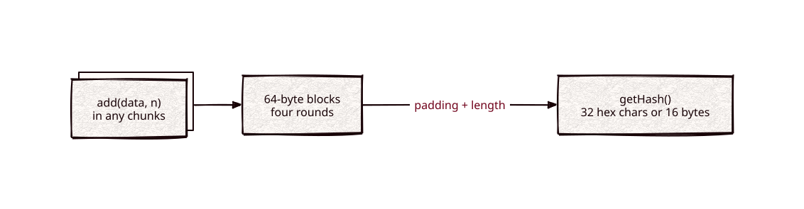

# md5

Part of [Kronuz C++ Libraries](https://github.com/Kronuz/cpp-libraries), a collection of small, reusable C++ libraries.

[](https://github.com/Kronuz/md5/actions/workflows/ci.yml)
[](LICENSE)


MD5 for C++20 in one small class: hash a buffer in one call or stream it in
chunks, and get 32 hex characters or the raw 16 bytes. For formats and protocols
that require MD5, such as `Content-MD5` or legacy checksums.



## ✨ Highlights

- **One call or streaming.** `md5("abc")`, or `add()` chunks and `getHash()`.
- **Hex or raw.** 32 lowercase hex characters, or 16 bytes into your buffer.
- **Any input.** Size-based, so embedded NULs count; buffers at any alignment are
  read safely.
- **Repeatable reads.** `getHash()` finalizes a copy, so you can keep adding.
- **Checked** against the RFC 1321 test suite and, where OpenSSL is installed, against
  OpenSSL's MD5 on every length to 1100, random lengths to 70,000, and streams past 512 MiB.

## 📦 Installation

Requires a C++20 compiler and CMake 3.14 or newer; it fetches
[endian](https://github.com/Kronuz/endian) and compiles one source file. CI builds
it on Linux (x86_64, arm64), macOS (arm64, x86_64), and FreeBSD, plus ASan,
UBSan, and TSan builds.

```cmake
include(FetchContent)
FetchContent_Declare(md5
  GIT_REPOSITORY https://github.com/Kronuz/md5.git
  GIT_TAG        main)
FetchContent_MakeAvailable(md5)

target_link_libraries(my_app PRIVATE md5::md5)
```

## 🚀 Quick start

```cpp
#include "md5.h"

#include <cstdio>

int main() {
	MD5 md5;
	std::puts(md5(std::string_view("abc")).c_str());   // 900150983cd24fb0d6963f7d28e17f72
}
```

[`examples/demo.cc`](examples/demo.cc) hashes a buffer with an embedded NUL and
shows streaming matching the one-shot digest.

## 🎯 When to use it

- ✅ Interoperating with something that requires MD5.
- ❌ Security of any kind: MD5 collisions are cheap to produce. Use
  [sha256](https://github.com/Kronuz/sha256) for fingerprints, and a reviewed
  cryptography library for anything adversarial.

## ⚡ Performance

The compression function is scalar C++. The hex string is sized once and filled
two characters per byte. `md5_hex_bench` times `MD5(data)` with its 32-character hex
string against OpenSSL's MD5 through EVP, found by CMake when installed and linked by
the benchmark only. OpenSSL 3 looks the algorithm up on every
`EVP_DigestInit_ex(ctx, EVP_md5())`, so the table shows OpenSSL twice: with the lookup
done once (`EVP_MD_fetch`) and with `EVP_md5()` on every call. ns per call, one thread,
best of two runs of seven windows, Apple clang 17 with `-O3`:

| Bytes | MD5 + hex | EVP + hex | EVP raw, `EVP_md5()` |
| ---: | ---: | ---: | ---: |
| 16 | 114 | 80 | 181 |
| 64 | 171 | 142 | 246 |
| 1,024 | 1,360 | 1,244 | 1,360 |
| 65,536 | 82,700 | 75,300 | 76,300 |
| 1,048,576 | 1,320,000 | 1,216,000 | 1,216,000 |

Apple M4 Pro, OpenSSL 3.5.9.

| Bytes | MD5 + hex | EVP + hex | EVP raw, `EVP_md5()` |
| ---: | ---: | ---: | ---: |
| 16 | 191 | 121 | 359 |
| 64 | 275 | 196 | 434 |
| 1,024 | 1,730 | 1,337 | 1,622 |
| 65,536 | 100,100 | 77,800 | 78,200 |
| 1,048,576 | 1,603,000 | 1,246,000 | 1,245,000 |

Intel Core i9-9980HK, OpenSSL 3.6.5.

OpenSSL's MD5 is faster once the lookup is out of the loop: 1.4x at 16 bytes and 1.1x from
1 KiB up on the M4 Pro, 1.6x and 1.3x on the i9. The lookup costs OpenSSL 105 ns (M4 Pro)
and 237 ns (i9) per call, which puts this MD5 ahead of `EVP_md5()` up to 64 bytes. Run the
benchmark with:

```sh
cmake -B build -DCMAKE_BUILD_TYPE=Release -DMD5_BUILD_BENCH=ON && cmake --build build && ./build/md5_hex_bench
```

## 📚 Documentation

- [docs/API.md](docs/API.md): the `MD5` class and caveats.
- [ARCHITECTURE.md](ARCHITECTURE.md): buffering, the rounds, and finalization.
- [AGENTS.md](AGENTS.md): repository map and invariants.
- [CHANGELOG.md](CHANGELOG.md): behavior and performance changes.

## 🛠️ Building and testing

```sh
cmake -B build && cmake --build build && ctest --test-dir build
./build/md5_demo
```

## 🤝 Contributing

Issues and pull requests are welcome. Read [AGENTS.md](AGENTS.md) first. CI must
pass on every platform.

## 📄 License

MIT, Copyright (c) 2015-2018 Dubalu LLC; portions Copyright (c) 2014, 2015 Stephan
Brumme. See [LICENSE](LICENSE). Extracted from
[Xapiand](https://github.com/Kronuz/Xapiand).
