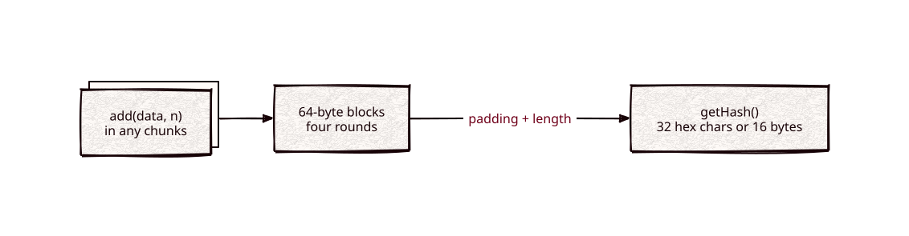

# md5

Part of [Kronuz C++ Libraries](https://github.com/Kronuz/cpp-libraries), a collection of small, reusable C++ libraries.

[](https://github.com/Kronuz/md5/actions/workflows/ci.yml)
[](LICENSE)


MD5 for C++20 in one small class: hash a buffer in one call or stream it in
chunks, and get 32 hex characters or the raw 16 bytes. For formats and protocols
that require MD5, such as `Content-MD5` or legacy checksums.



## ✨ Highlights

- **One call or streaming.** `md5("abc")`, or `add()` chunks and `getHash()`.
- **Hex or raw.** 32 lowercase hex characters, or 16 bytes into your buffer.
- **Repeatable reads.** `getHash()` finalizes a copy, so you can keep adding.
- **Checked** against the RFC 1321 test suite.

## 📦 Installation

Requires a C++20 compiler and CMake 3.14 or newer; it fetches
[endian](https://github.com/Kronuz/endian) and compiles one source file. CI builds
it on Linux (x86_64, arm64), macOS (arm64, x86_64), and FreeBSD, plus ASan,
UBSan, and TSan builds.

```cmake
include(FetchContent)
FetchContent_Declare(md5
  GIT_REPOSITORY https://github.com/Kronuz/md5.git
  GIT_TAG        main)
FetchContent_MakeAvailable(md5)

target_link_libraries(my_app PRIVATE md5::md5)
```

## 🚀 Quick start

```cpp
#include "md5.h"

#include <cstdio>

int main() {
	MD5 md5;
	std::puts(md5(std::string_view("abc")).c_str());   // 900150983cd24fb0d6963f7d28e17f72
}
```

[`examples/demo.cc`](examples/demo.cc) hashes a buffer with an embedded NUL and
shows streaming matching the one-shot digest.

## 🎯 When to use it

- ✅ Interoperating with something that requires MD5.
- ❌ Security of any kind: MD5 collisions are cheap to produce. Use
  [sha256](https://github.com/Kronuz/sha256) for fingerprints, and a reviewed
  cryptography library for anything adversarial.
- ⚠️ Unaligned buffers are read through a misaligned pointer until a pending fix
  lands; see [docs/API.md](docs/API.md#caveats).

## ⚡ Performance note

The hex string is sized once and filled two characters per byte instead of appended one character at a time:
`MD5(16 B)` to a 32-character string went from about 161 ns to 115 ns (Apple M4 Pro, -O3). The digest bytes are
unchanged; the compression function is the same scalar code. `bench/hex_bench.cc` (`-DMD5_BUILD_BENCH=ON`).

## 📚 Documentation

- [docs/API.md](docs/API.md): the `MD5` class and caveats.
- [ARCHITECTURE.md](ARCHITECTURE.md): buffering, the rounds, and finalization.
- [AGENTS.md](AGENTS.md): repository map and invariants.

## 🛠️ Building and testing

```sh
cmake -B build && cmake --build build && ctest --test-dir build
./build/md5_demo
```

## 🤝 Contributing

Issues and pull requests are welcome. Read [AGENTS.md](AGENTS.md) first. CI must
pass on every platform.

## 📄 License

MIT, Copyright (c) 2015-2018 Dubalu LLC; portions Copyright (c) 2014, 2015 Stephan
Brumme. See [LICENSE](LICENSE). Extracted from
[Xapiand](https://github.com/Kronuz/Xapiand).
